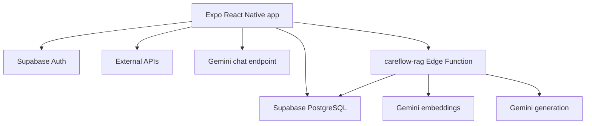
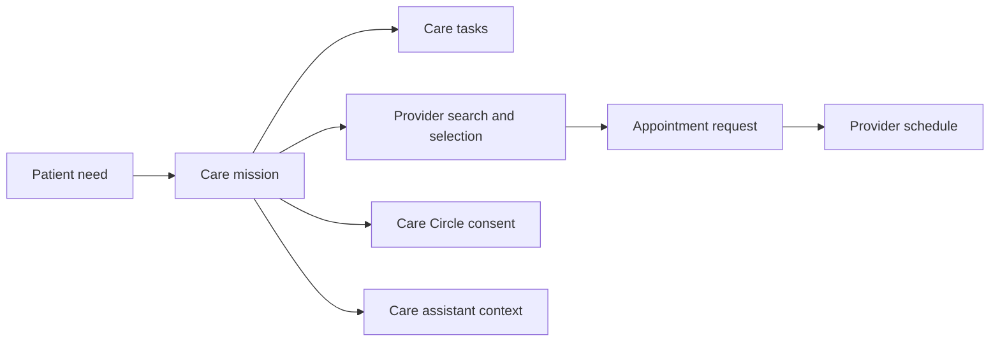

# Architecture

This file is the short architecture reference. The detailed, source-backed
documentation is organized under [`docs/`](./docs/README.md).

## As-built system

The app uses file-based routes in [`app/`](./app), shared auth/location state
from [`AuthContext`](./context/AuthContext.tsx), and domain services in
[`services/`](./services). Most care-workflow operations are direct Supabase
queries. The repository migration defines only the RAG tables and RPCs; the
broader workflow schema is represented by the supplied live-schema reference in
[`DATABASE.md`](./DATABASE.md), not by reproducible migrations in this repository.

## Authentication and authorization

`AuthProvider` restores the local Supabase session, subscribes to auth changes,
loads `profiles.role`, and requests device location. The tab layout hides
patient/provider tabs based on that role. These are client UX controls, not an
authorization boundary. Database access depends on the deployed Supabase
schema and RLS policies.

The signup UI can pass provider metadata and the provider onboarding screen can
insert a provider row. This is not equivalent to a controlled provider
approval workflow. See [authentication](./docs/features/authentication.md) and
[security and RLS](./docs/database/security-and-rls.md).

## Care workflow

Missions, tasks, events, providers, availability, appointments, caregivers,
consents, and conversations are accessed through the corresponding service
modules. Runtime statuses are lowercase strings/enums in the deployed schema;
the unused [`data/mockDb.ts`](./data/mockDb.ts) contains a separate demo model
and should not be treated as the live source of truth.

## AI layers

The main assistant persists conversations and messages, classifies requests
with a Zod schema, and executes application actions in
[`services/chatOrchestrator.ts`](./services/chatOrchestrator.ts). The record
assistant is separate: it sends daily-log/document ingestion and questions to
the authenticated [`careflow-rag`](./supabase/functions/careflow-rag/index.ts)
function. Neither path should be described as clinical diagnosis.

## Target-state decisions

The repository still intends to move privileged AI calls server-side, enforce
role approval and route guards, add reproducible workflow migrations, use
Supabase Storage for original medical files, and harden RLS. Those are target
state, not claims about the current client.
