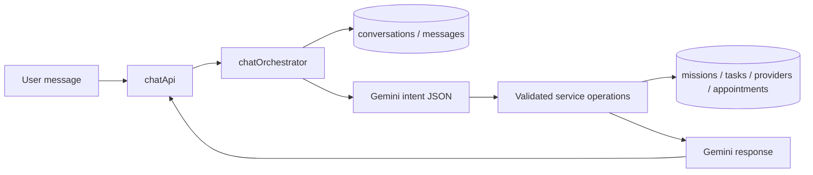

# Care assistant

The main Care Assistant is the persistent conversational workflow interface in
[`app/(tabs)/assistant.tsx`](../../app/(tabs)/assistant.tsx). It is distinct from
the record-focused RAG assistant.

## Flow

The orchestrator uses Zod to parse the intent response, loads conversation
history and optional mission/profile/document context, executes deterministic
Supabase operations, and writes the assistant reply. Older messages can be
summarized into `conversation_states.summary`.

## Status and limitations

**Implemented, prototype quality.** The client currently sends the Gemini
credential through `EXPO_PUBLIC_GEMINI_API_KEY`. The system has no server-side
rate limiting or complete prompt-injection defense, and several database errors
are logged rather than returned as structured failures. The assistant must not
be described as a diagnostic or autonomous clinical agent.
