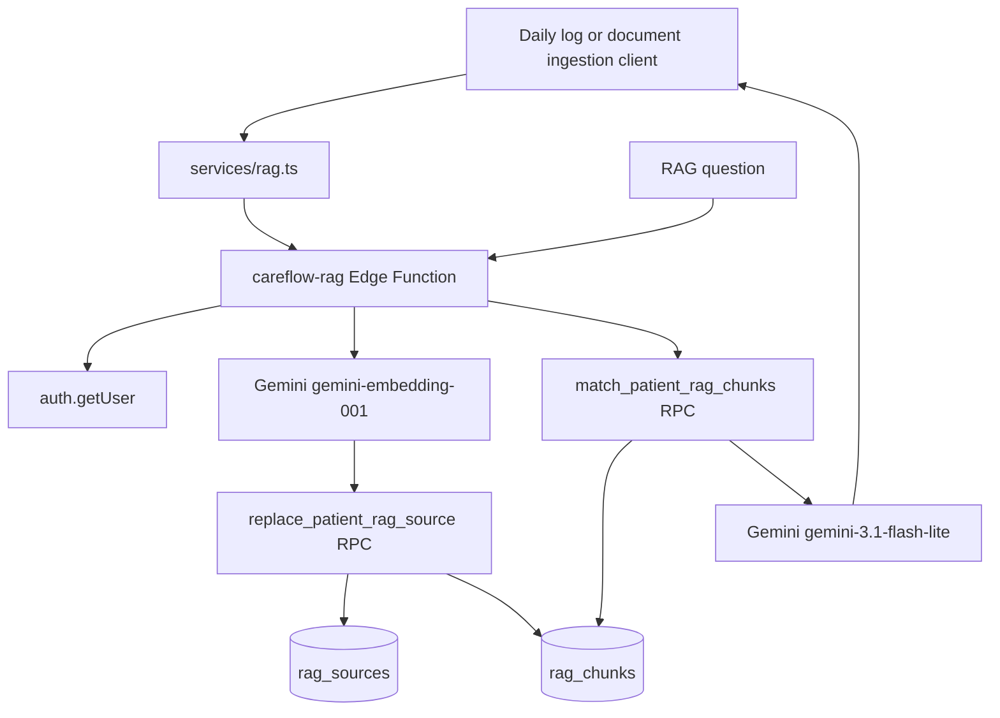

# RAG system

The record assistant at [`/ragassistant`](../../app/ragassistant.tsx) answers
questions using authenticated indexed records. It is separate from the main
Care Assistant. The Edge Function supports document ingestion, but the current
Documents screen sends OCR text to Gemini for task generation instead of
calling `ingest_document`.

## End-to-end flow

## Ingestion

`ingest_daily_log` converts the structured payload into vitals, activity,
wellness, adherence, context, and additional-field text chunks. `ingest_document`
accepts OCR text and stores it as `medical_document`. Each source is capped at
60,000 characters and 40 chunks; each chunk is embedded sequentially at 768
dimensions.

The RPC stores source metadata and chunks, replacing chunks when the same
`sourceId` is supplied. The current screens normally generate a new source per
submission.

## Retrieval

`ask` embeds a question, calls `match_patient_rag_chunks` with top-k 5, discards
matches below similarity `0.25`, and asks Gemini to answer only from the
remaining records. The response includes source title/type/date metadata. The
RPC derives the owner from `auth.uid()` and does not accept a client patient ID.

## Security and limits

The Edge Function requires a bearer token and `verify_jwt = true`. RLS and
security-definer RPCs isolate RAG rows by authenticated user. Gemini credentials
for this path are server-side `GEMINI_API_KEY` and optional
`GEMINI_GENERATION_MODEL`.

Original images are not stored in Supabase Storage. Conversation history is not
sent with each RAG question; each query retrieves independently. This is a
prototype retrieval aid, not a medical device or clinical decision-support
system.
