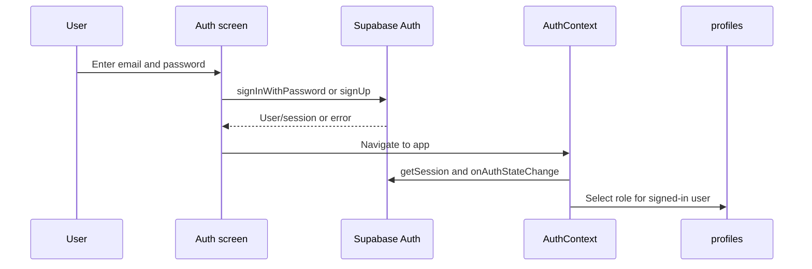
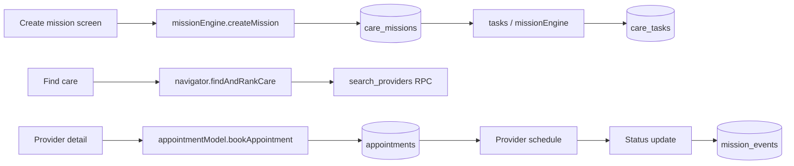
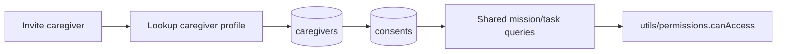

# End-to-end data flows

## Authentication

Signup can route to patient or provider onboarding based on client metadata.
Email verification, password reset, and route-level guards are incomplete.

## Mission and appointment

The runtime uses lowercase status values in services. Chat booking writes
`scheduled`, while the normal booking path writes `requested`; provider UI
handling is not fully consistent.

## Care Circle

The client contains consent checks, but permission keys and sharing payloads are
not consistent across all paths. Database policy behavior is supplied by the
deployed schema documented in [`DATABASE.md`](../../DATABASE.md).

## Document OCR and task creation

The Documents screen accepts an image, calls OCR.Space, and displays extracted
text. At the user's request it sends the text to Gemini from the Expo client
using `EXPO_PUBLIC_GEMINI_API_KEY`, parses a JSON task array, selects the most
recent active mission (or creates a default prescription mission), and inserts
each task through `missionEngine.addTaskToMission`.

The screen does not persist OCR text through RAG, create a `documents` metadata
row, or store the original image in Supabase Storage.

## RAG ingestion and retrieval

The Daily Log screen calls [`services/rag.ts`](../../services/rag.ts), which
invokes the authenticated Edge Function. The function validates the bearer
session, creates 768-dimensional Gemini embeddings, and calls
`replace_patient_rag_source`. Questions use `match_patient_rag_chunks`, filter
similarity below `0.25`, and send relevant chunks to Gemini for a cited answer.
