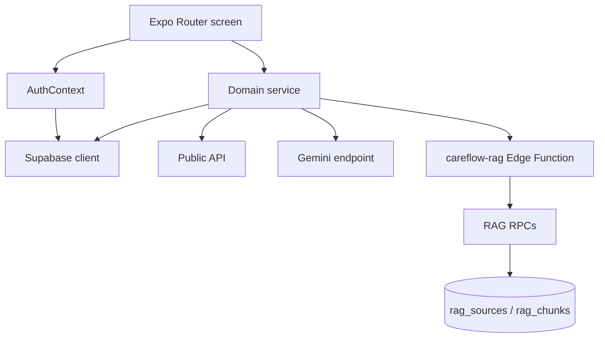

# Architecture overview

## Repository shape

```text
app/                 Expo Router screens and route layouts
components/          Reusable React Native UI
context/              Session, role, and location state
services/             Supabase, domain, external API, and AI clients
data/mockDb.ts        Unused in-memory demo model
supabase/migrations/  Source-controlled RAG migration only
supabase/functions/  careflow-rag Edge Function
```

The app is a client-heavy Expo prototype. Domain services call Supabase
directly with the publishable client. The live schema reference in
[`DATABASE.md`](../../DATABASE.md) documents additional deployed objects, but
the repository does not contain migrations that recreate them.

## Navigation

The root route redirects to `/auth`. `/auth` and `/login` are separate login
screens. Patient tabs are Home, Assistant, Care, and Profile; provider tabs are
Home, Schedule, and Profile. Additional stack routes cover onboarding,
missions, providers, appointments, documents, daily logs, nutrition, and RAG.
The tab layout hides tabs by role but does not prevent direct navigation.

## Runtime layers



The main assistant currently calls Gemini from
[`chatOrchestrator.ts`](../../services/chatOrchestrator.ts) using the
client-bundled `EXPO_PUBLIC_GEMINI_API_KEY`. The RAG assistant keeps Gemini
calls in the Edge Function and uses `auth.uid()`-scoped RPCs.

## Data authorities

- Supabase Auth is authoritative for sessions and user IDs.
- The deployed PostgreSQL schema is authoritative for workflow records.
- `DATABASE.md` is a live/exported schema reference, not a migration.
- `data/mockDb.ts` is demo data and is not used by production screens.
- RAG source/chunk writes are performed through the two migration-defined RPCs.

## Target-state boundaries

Route guards, provider approval, complete server-side AI orchestration,
reproducible workflow migrations, Storage-backed original files, and exhaustive
RLS tests remain target or incomplete work. See
[known limitations](../maintenance/known-limitations.md).
